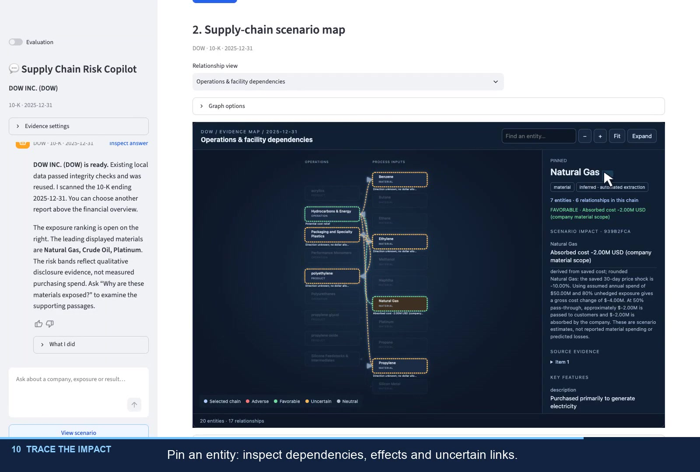

# Supply Chain Risk Copilot

**From company disclosures to financial downside scenarios—with evidence you can inspect.**

A hands-on AI product prototype for exploring how commodity shocks could affect a company's margins, earnings and cash flow. It connects research, explicit assumptions and financial calculations in one analyst workflow.

**[▶ Watch the 90-second DOW demo](https://github.com/lichaowow6666/supply-chain-risk-copilot/raw/refs/heads/main/docs/demo/DOW-copilot-walkthrough.mp4)** · [Technical design](docs/technical_overview.md) · [Evaluation](docs/evaluation_methodology.md)

## The question

**“If energy costs rise, how exposed is this business—and what would protect its earnings?”**

For investment diligence and portfolio monitoring, the useful output is a traceable scenario: which exposures matter, which assumptions drive the result, and what needs further investigation.

## See the decision workflow

1. **Find the exposure.** Select a company's SEC filing and inspect cited material exposures.
2. **Stress the assumptions.** Explore commodity prices and forecasts; set spend, hedging and cost pass-through.
3. **Explain the impact.** Trace contributions to margins, earnings and cash flow, then inspect supply-chain relationships and supporting evidence.

The DOW demo combines public filing evidence with **illustrative scenario assumptions**. Results are conditional stress estimates; graph relationships do not establish product-level dollar allocations.

## What I built

- **An interactive product:** conversational discovery and a visual workspace for scenarios, graphs and answer inspection.
- **An evidence pipeline:** report-scoped hybrid retrieval, reranking and GraphRAG.
- **A controlled calculation workflow:** LangGraph coordinates agents; Python calculates financial impacts; the LLM explains the evidence.
- **An evaluation loop:** answer traces, RAGAS, user feedback and a saved 100-question synthetic benchmark.

## Explore further

The video, documentation and code can be reviewed **without installing the app**.

[Architecture and implementation](docs/technical_overview.md) · [Evaluation methods and results](docs/evaluation_methodology.md) · [Demo assumptions](docs/walkthrough.md) · [Local setup and current scope](docs/running_locally.md) · [All documentation](docs/README.md)

**Prototype status:** scenarios run in the visual workspace. Chat-driven scenario execution, portable clean installation and enterprise permissions are in development.
