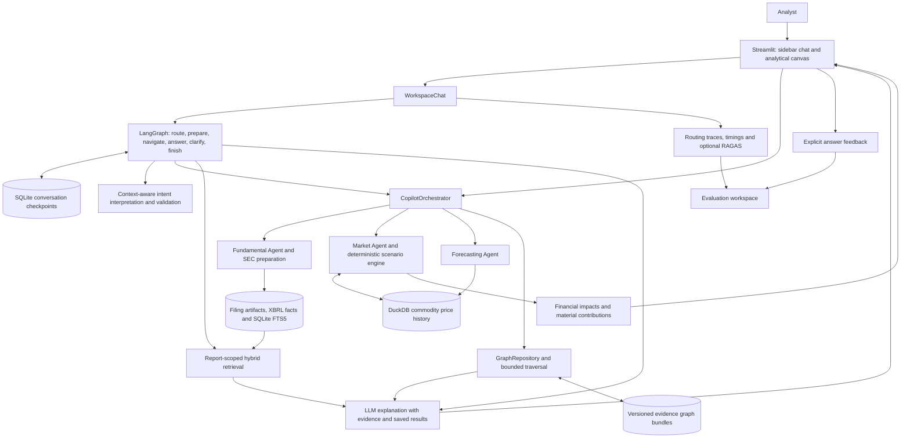

# Technical design and measured results

Detailed implementation notes for [Supply Chain Risk Copilot](../README.md). All published evaluation examples use fictional companies and synthetic data.

## Architecture



Three layers have distinct responsibilities:

- **LangGraph manages conversational control flow.** A real `StateGraph` selects preparation, navigation, explanation, or clarification. SQLite checkpoints and `interrupt`/`Command(resume=...)` support clarification across turns. Conversation threads are scoped by session, company, and report.
- **The orchestrator coordinates reusable business capabilities.** Typed requests and results connect company preparation, discovery, forecasting, scenario calculation, and graph analysis. The Streamlit backend is [`pe_copilot/orchestrator.py`](../pe_copilot/orchestrator.py); its typed request/result contracts are shared by the chat and analytical canvas.
- **Agents and domain services do the work.** These are explicit Python capabilities with traceable inputs and outputs. Financial calculations remain ordinary Python functions; language models interpret requests and synthesize explanations.

This division makes state transitions inspectable without moving financial logic into prompts. LangGraph provides resumable workflow semantics; NetworkX represents business relationships. They solve different problems. A larger autonomous-agent framework or distributed graph database would add operational complexity without resolving the prototype's current evidence-quality gaps.

## Evidence and retrieval

### One selected filing defines the analytical scope

Company preparation collects the latest three annual reporting periods and corresponding available quarterly filings, reusing validated local data where possible. Each filing retains company identity, accession, form, reporting period, source URL, and content fingerprints. Inline-XBRL facts preserve their units and period context; paragraph and table structure inform text chunks.

The selected accession scopes financial baselines, exposure analysis, and retrieval. This prevents a question about a quarterly filing from silently retrieving the prepared annual baseline. Exposure rankings are qualitative assessments supported by disclosures, not risk scores reported by the company.

Preparation supports **10-K and 10-Q**, including amendments. Missing history is reported; issuers filing only 20-F/6-K are outside the current preparation flow.

### Hybrid search followed by reranking

1. **Scope first:** select the company's chosen report before ranking evidence.
2. **Retrieve:** combine SQLite FTS5/BM25 lexical search with normalized **BAAI BGE-M3** dense embeddings through Sentence Transformers.
3. **Fuse:** use reciprocal rank fusion to combine keyword and semantic matches.
4. **Rerank:** apply the English `cross-encoder/ms-marco-MiniLM-L6-v2` model, served through ONNX in the verified local configuration.
5. **Explain:** supply evidence, structured financial context, and saved scenario results to the LLM, retaining citation identifiers.

Here, “hybrid” means BM25 plus BGE-M3 dense retrieval; it does not mean BGE-M3's learned sparse or multi-vector heads are enabled. Non-Latin queries skip the English reranker. A matching full-report vector cache supports report-wide dense search; cold retrieval uses a bounded candidate pool and exposes that coverage. Missing dense models produce an explicit lexical fallback.

### A graph of evidence, not inferred dollar allocations

| Graph record | Purpose |
|---|---|
| **Entity** | A company, segment, material, product, facility, or other typed concept with a stable identity. |
| **GraphClaim** | A directed subject–relationship–object edge, with provenance and review state. |
| **Observation** | A dated numeric measurement or explicit missing value, retaining units, currency, and reported/derived/assumed basis. |
| **GraphSnapshot** | A company/report-specific view of entities, claims, observations, and citations. |

Versioned JSON bundles retain evidence and provenance; NetworkX `MultiDiGraph` supports directed traversal and multiple claims between entities. The graph artifact is separate from the passage index because typed relationships and dated measurements serve a different purpose from semantic text ranking. Shared source references connect them.

For graph-routed company questions, **application-level GraphRAG** adds bounded relationship paths and their citations to the answer context. This is not the Microsoft GraphRAG community-summary pipeline. The current chat consumes graph evidence; automatically applying a chat answer's highlight to the canvas is **in development**.

The scenario canvas already provides an interactive graph using **custom SVG and JavaScript**, with node pinning, pan/zoom, evidence inspection, and persistent impact colors. Relationship visibility explains an exposure chain; it does not establish product-level spend weights or a calibrated causal model.

## Forecasting and financial reasoning

**Market foundation.** DuckDB stores daily prices for 11 commodity futures benchmarks, including precious metals, copper, aluminum, natural gas, crude oil, gasoline, and heating oil. Refresh is checked once per day when the copilot runs. Failed updates retain prior history and expose freshness limitations. These market benchmarks are not the company's delivered purchase prices or actual hedge positions; unsupported materials remain visibly uncovered.

**Forecast validation.** The forecasting service compares no-change, autoregressive, XGBoost, and optional experimental PyTorch LSTM models, with seasonal autoregression additionally available for Natural Gas. Chronological development windows guide selection; later audit windows assess performance without selecting the winner. A challenger must improve development MAE by more than 5% over the no-change benchmark to replace it as the default. Empirical 80% intervals expose uncertainty, while the analyst chooses the scenario price independently of the central forecast.

**Financial attribution.** Per-material contributions reconcile to the company-level cost waterfall. The core relationship is:

```text
Net absorbed cost = entered period spend
                  × price shock
                  × unhedged fraction
                  × (1 − pass-through fraction)

Change in COGS             = + net absorbed cost
Change in operating income = − net absorbed cost
```

For a **synthetic illustration**, USD 100 million of annual material spend, a +20% price shock, 80% unhedged exposure, and 50% pass-through produce **USD 8 million higher net COGS and USD 8 million lower operating income**. These assumptions do not establish how much belongs to any particular product.

The model holds volume fixed and applies the selected price change across the entered spending period; a 30-day price horizon does not automatically create a 30-day earnings estimate. Broader financial outputs use simplified assumptions, including a fixed 21% tax effect and a cash-based debt trigger. They are conditional stress calculations, not a full accounting or valuation model.

Where sufficient aligned history exists, company-risk distributions reuse matched forecast-error observations across materials and pass them through the same financial engine. This preserves observed co-movement within the sample without presenting it as a calibrated earnings forecast.

## Measured results

### Answer quality and workflow behavior

The saved **100-question synthetic evaluation**, completed on **23 September 2026**, exercises the actual chat/LangGraph path using fictional company filings and prices. It covers disclosures, financial interpretation, graph relationships, scenarios, forecasts, education, navigation, and governance: **90 English and 10 Chinese questions**. Generation and judging used DeepSeek `deepseek-chat`; retrieval used base BGE-M3.

| RAGAS metric | What it assesses | Mean score | Scored / 100 |
|---|---|---:|---:|
| Faithfulness | Support for answer claims in supplied context | 0.712 | 66 |
| Answer relevance | Alignment between the answer and question | 0.713 | 78 |
| Context precision, without reference | Usefulness of supplied evidence for the answer | 0.332 | 66 |
| Context recall | Coverage of reference-answer information by context | 0.801 | 66 |
| Factual correctness | Claim-level agreement with the reference answer | 0.474 | 78 |

The run produced **354 numerical scores with no judge failures or missing scores**. Navigation, clarification, and other non-generated replies can be N/A; general explanations may have answer metrics without filing-context metrics. N/A is neither zero nor a pass.

| Deterministic workflow check | Observed result |
|---|---:|
| Strict authored routing/workflow contract | **70/100** |
| Existing analysis state preserved | **99/99 applicable** |
| Selected company/report scope retained in replies | **90/90 applicable** |
| Source scope and provenance checks | **72/72 applicable each** |
| Valid inline citation identifiers | **67/67 applicable** |
| Saved analytical results reused | **12 scenario reads + 4 forecast reads** |

Twenty of the 30 strict-contract failures were section-label-only mismatches. Identifier and scope checks establish boundaries, not factual entailment. These results show useful state preservation and service reuse alongside unresolved routing and answer-quality problems.

**Interpretation matters.** This is an assistant-authored development suite, not an independent production audit. The same model generated and judged answers. Metric eligibility follows the actual route: three incorrectly general-routed company questions skipped context metrics. Context precision evaluates saved source blocks, including structured financial facts, rather than only the reranker's original order. The averages therefore do not represent end-to-end business accuracy or a standalone retrieval benchmark.

Sources: [authored cases and expected outcomes](../evaluations/interview_100_v1.json), [complete saved results](../evaluations/results/interview_100_latest.json), and [evaluation methodology](evaluation_methodology.md).

### Latency

| Recorded operation | Observations | Median | p95 |
|---|---:|---:|---:|
| Server-side answer handling | 100 | **2.956 s** | **3.493 s** |
| Sequential language-call time per answer with calls | 94 | 2.874 s | 3.303 s |
| Optional answer judging | 78 | 8.550 s | 15.069 s |

The slowest answer took **20.391 s**, including first-use model warm-up. Measurements use monotonic timers around real operations. Language-call duration includes provider/network time; it does not isolate hidden model “thinking.” Nested timings overlap and must not be added. This was one local sequential run with shared caches, not a concurrency or SLA test.

### Embedding fine-tuning: an experiment with a deployment decision

The versioned `synthetic-company-holdout-v1` dataset contains **72 passages and 144 bilingual questions**, split by company into training, development, and audit sets. The experiment tunes BGE-M3's final attention query/value parameters—approximately 2.1 million parameters—using `MultipleNegativesRankingLoss`, 24 steps, a fixed seed, and a 128-token training limit. It is dense-encoder fine-tuning, not generative-LLM tuning or LoRA.

| Audit Recall@1, 18 questions per language | Base English | Tuned English | Base Chinese | Tuned Chinese |
|---|---:|---:|---:|---:|
| Dense BGE-M3 | 100% | 100% | 72.2% | 72.2% |
| BM25 + dense reciprocal rank fusion | 100% | 94.4% | 22.2% | 22.2% |

**The experiment did not establish an improvement, so base BGE-M3 remains the default.** The tuned checkpoint is an explicit experimental comparison. The small synthetic audit uses overlapping templates and nine candidate passages per scoped report; serving uses a longer 512-token limit. These results do not establish production generalization.

The [dataset](../evaluations/embedding_v1/dataset.json), [training configuration](../evaluations/embedding_v1/training_config.json), and [comparison results](../evaluations/results/embedding_comparison_v1.json) preserve the experiment's lineage without publishing local model weights.

## Observability, governance, and feedback

Each answer can expose its actual LangGraph path, validated routing decision, invoked or reused capabilities, sources, quality scores, and timings in an optional inspection panel. This is execution evidence, not a display of hidden chain of thought. Failed or unavailable capabilities are distinguished from successful calls.

Report scoping, citation identifiers, source provenance, and explicit assumption labels provide concrete content-governance controls. A separate synthetic permission demonstration tests allow/deny behavior; authenticated enterprise identities and retrieval-time access controls remain **in development**.

Thumbs-up/down feedback is available beside answers, with selectable reasons for negative ratings. The Evaluation workspace aggregates ratings and reasons. Feedback storage retains anonymous identifiers and rating metadata rather than question or answer text; changing a vote replaces it. Optional usage telemetry is separate and off by default.

The feedback loop supports reviewing failures and adding regression cases. It does not automatically retrain models. Real analyst adoption, retention, and financial ROI remain unmeasured; scripted completion rates are not substitutes for those outcomes.

## Code organization

```text
app.py                         Streamlit application and workspace composition
pe_copilot/
  orchestrator.py              Shared business-service coordination
  contracts.py                 Typed analysis requests, results, and provenance
  chat/                       LangGraph, routing, retrieval, explanations, evaluation
  agents/                     Fundamental, market, and forecasting capabilities
  filings/                    SEC collection, parsing, indexing, and report analysis
  supply_chain/               Evidence graph schema, snapshots, traversal, and impacts
  analytics/                  Deterministic financial, attribution, and risk calculations
  ui/                         Chat, charts, scenario canvas, graph, and Evaluation
  native_runtime.py           Isolated native-model execution
evaluations/                  Versioned synthetic datasets and saved comparisons
tests/                        Focused behavioral and regression checks
docs/                         Design rationale, methodology, and implementation records
```

Native embedding and forecasting workloads run in isolated processes to reduce conflicting native-library runtimes in the UI process. Filing artifacts, databases, vector caches, credentials, and model weights remain local and are excluded from the public repository.

## Next quality gates

The next priorities follow the measured gaps: strengthen routing and metric applicability, add deterministic numeric assertions for generated explanations, obtain independent analyst review of references, and expand retrieval evaluation beyond synthetic templates. Enterprise authorization, controlled load testing, and a real-user adoption study are **in development**.
